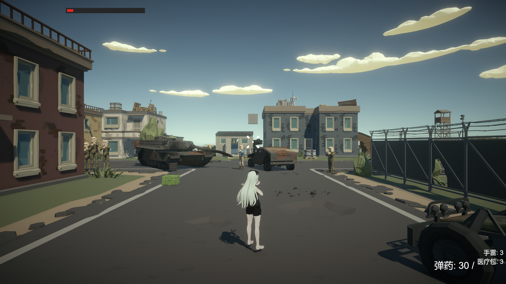

# TPS Demo - AI

第三人称战术射击（TPS）**波次生存**游戏示例项目，采用 AI 多 Agent 工作流（architect → coder → explore）按任务包推进开发。



## 项目信息

- 引擎版本：Unity 2022.3.62f2c1（LTS）
- 渲染管线：URP（Universal Render Pipeline）
- 输入：新 Input System | 相机：Cinemachine 3（肩越视角 + 遮挡自动拉近）
- 动画：Mixamo 动画 + 上半身 AvatarMask 分层（射击/换弹不打断移动）
- 资源包：PolygonBattleRoyale 低多边形军事包 + P08 角色模型
- 第三方：DOTween（UI 缓动）

## 玩法

在 800m 低多边形军事岛屿上抵御 **5 波**逐波增强的敌人（8/8/10/12/14，三种兵种混编）：

- 敌人从远离玩家的出生点刷出并**主动围攻**，波间 5s 倒计时提示
- 全灭一波自动进入下一波，每波开始自动补充 1 枚手雷
- 打完全部 5 波进入 **VICTORY** 结算；阵亡进入 **YOU DIED** 结算（击杀数 / 存活波次 / 存活时间，可重玩或回主菜单）

## 功能清单

| 系统 | 内容 |
|------|------|
| 玩家操作 | 移动/奔跑/跳跃、蹲伏、ADS 瞄准（FOV 收窄+散布收敛）、3 武器切换（SO 数据驱动）、左手 IK 护木吸附 |
| 射击手感 | Raycast+散布+后坐力、WeaponSway 武器惯性摆动、HeadBob 视角起伏、HitMarker 命中标记、HEADSHOT 爆头提示 |
| 战斗表现 | 命中溅血/烟尘粒子、弹痕（50 上限循环）、子弹曳光、手雷投掷（准星瞄点/抛物线弹跳/范围伤害/震屏）、对象池 |
| 敌人 AI | 巡逻/追击/攻击、Raycast 弹道（隔掩体不扣血）、命中率散布、部位伤害（爆头 ×2）、死亡动画 + 尸体延时销毁 |
| 流程闭环 | GameManager 状态机（Playing/Paused/GameOver/Victory）、波次生成器 + WaveConfig SO 配置、击杀统计 HUD、波次横幅与来袭倒计时 |
| 界面 | 主菜单（设置持久化：灵敏度/FOV/音量/自动射击）、暂停菜单、死亡/胜利结算、HUD（血条/弹药/医疗包/手雷/击杀数） |

## 操作

| 按键 | 功能 |
|------|------|
| WASD / Shift / Space | 移动 / 奔跑 / 跳跃 |
| 鼠标左键 / 右键 | 射击 / ADS 瞄准 |
| R | 换弹 |
| 1 / 2 / 3 | 切换步枪 / 冲锋枪 / 手枪 |
| G | 投掷手雷 |
| C | 蹲伏 |
| H | 使用医疗包 |
| Tab | 暂停 |

## 目录结构

```
Assets/
├── Scripts/
│   ├── Player/        # 玩家控制、ADS、蹲伏、IK、手雷投掷、Sway/HeadBob
│   ├── Combat/        # 武器、射击、手雷、拾取物、曳光、命中特效
│   ├── Enemy/         # 敌人 AI、波次生成器
│   ├── UI/            # HUD、菜单、结算面板、波次横幅
│   ├── Data/          # GameEvents 事件总线、GameManager、ObjectPool、WaveConfig
│   └── Audio/         # AudioManager（事件驱动，音效资产待接入）
├── Scenes/            # SampleScene（游戏主场景）、MainMenu
├── Prefabs/           # 自制预制体（敌人/武器/手雷/拾取物/特效）
├── Data/              # SO 数据资产（武器数据、波次表等）
├── Materials/         # 自定义材质
└── PolygonBattleRoyale/  # 第三方资源包（勿修改原文件）
Docs/                 # README 截图等项目文档资源
```

## 运行方式

1. 使用 Unity 2022.3.62f2c1 打开项目
2. 打开 `Assets/Scenes/MainMenu.unity`（或直接进 `SampleScene.unity`）
3. 点击 Play 运行

## 开发文档

- [DEVELOPMENT_PLAN.md](Assets/DEVELOPMENT_PLAN.md) — 总规划：差距分析、技术决策、接口定义、任务包路线
- [DEVLOG.md](Assets/DEVLOG.md) — 开发日志：各阶段实施记录与 **82 条已知坑**经验库
- [PHASE5_PLAN.md](Assets/PHASE5_PLAN.md) — 阶段 5「流程闭环」实施方案样本
- [TPS项目开发记录文档.md](TPS项目开发记录文档.md) — 从零复现本项目的教学文档

## 当前进度

- ✅ 阶段 1~3：玩家操作层 + 敌人基础 AI + 关卡搭建
- ✅ 阶段 4（4A/4C~4F）：基础设施（事件总线/对象池）、敌人升级、命中反馈、手雷、武器手感
- ✅ 阶段 5：流程闭环（GameManager/波次生存/结算界面/击杀统计/手雷补给）
- ⏸ 4B 音效：事件钩子与 AudioManager 已就绪，音效资产待接入
- ⬜ 阶段 6：AI 深度（视线感知/Search 状态/侧移射击/敌人血条等），规划中

## 开发说明

- 自定义脚本按系统分目录存放，私有字段 `_驼峰` 命名，中文注释关键逻辑
- 跨系统通信一律走 `GameEvents` 静态事件总线，组件间优先事件/委托解耦
- 优先复用 PolygonBattleRoyale 现成资源，需要变体时复制后修改，不改原文件
